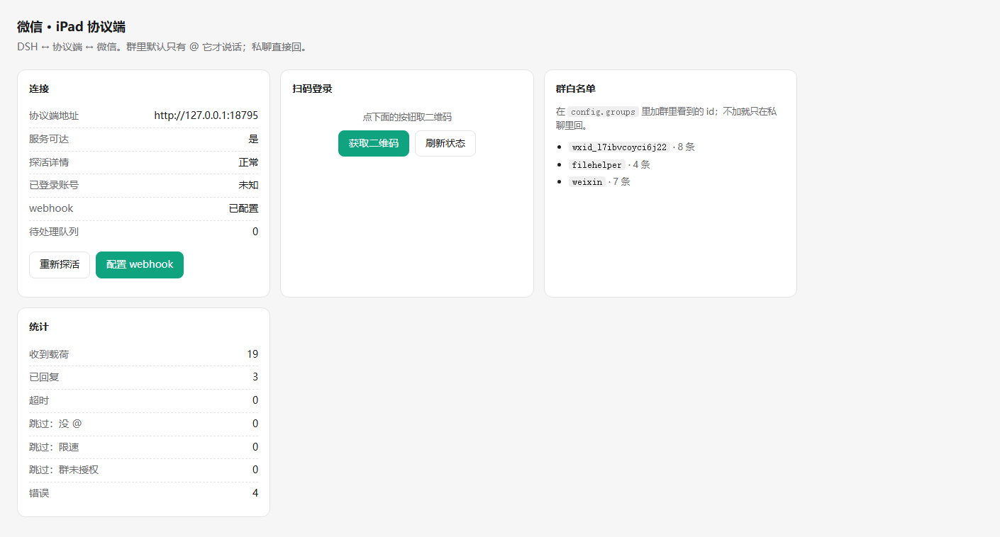
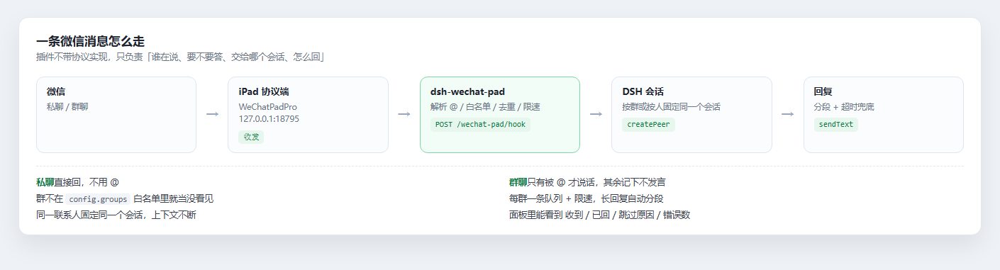

# dsh-wechat-pad

[](https://www.npmjs.com/package/dsh-wechat-pad)
[](https://github.com/QIC-9821/dsh-wechat-pad/actions/workflows/ci.yml)
[](LICENSE)
[](#安全与边界)

把**个人微信**接进 [DeepSeek Harness](https://github.com/deepseek-ai/deepseek-harness)：私聊随手回，群里被 @ 才说话。

它自己不含任何微信协议实现，而是连接一台**自建的 iPad 协议端**（目前适配 [WeChatPadPro](https://github.com/WeChatPadPro/WeChatPadPro) 的接口）。协议端负责登录、收发；本插件负责「谁在说、要不要答、交给哪个会话、怎么回」。

> ⚠️ 用非官方协议登录个人微信，**违反微信软件许可及服务协议，有被封号的风险**（轻则 1 天，重则永久）。请只在你自己的号、且你愿意承担后果时使用。本项目不提供协议端、不提供账号、不提供任何绕过风控的手段。

## 演示

控制面板 `/wechat-pad`：一眼看到协议端通不通、webhook 配没配、哪些群在白名单里，以及「收到多少 / 回了多少 / 为什么跳过」的计数。



一条消息从微信走到回复的完整链路：



## 它做什么

- **私聊**：对方发来，就回（可关）。
- **群聊**：只有 @ 到它时才答，答的时候带 `@对方` 前缀；不在白名单的群一律不说话。
- **每个群一个独立会话**：群里聊的、私聊聊的不会串在一起，各自有上下文。
- **控制面板**：`/wechat-pad` 扫码登录、看连接状态、开关群白名单、看统计。
- **webhook 自动接好**：装上、填好地址，插件启动时自己把回调地址写回协议端（也可手动关掉）。

## 工作原理

```
微信 ←→ 协议端（WeChatPadPro，跑在你自己的机器/云上）
                 │  webhook（消息）
                 ▼
        dsh-wechat-pad（Host 插件，跑在 DSH 里）
                 │  session/create · session/prompt · session/event
                 ▼
              DSH agent  ←→ 你的模型、你的工具、你的记忆
                 │  回答
                 ▼
        协议端 SendText → 微信
```

插件在 DSH **进程内**运行，直接调宿主的会话服务，不走 HTTP 中转，所以不需要 launch token，也没有额外端口（除了面板和 webhook 都挂在 DSH 自己的 webServer 上）。

## 前置条件

1. 一台能跑协议端的机器：Linux（推荐，Docker 也行）或 Windows；能 7×24 在线（协议端掉线 = 收不到消息）。
2. 一个**你愿意冒险**的微信号（建议用小号）。
3. 一个固定的出口 IP，以及一个能让协议端回调到的地址：如果协议端和 DSH 不在同一台机器，需要一个公网地址或隧道（cloudflared / frp / tailscale 都行），并且 webhook 路径能直通 DSH。
4. DSH 0.2.x（桌面包或 `dsh` CLI 均可）。

## 安装

在 DSH 的 profile 里装（三选一）：

```bash
# npm（推荐）
dsh plugin add dsh-wechat-pad

# 直接从 GitHub tag 装
dsh plugin add github:QIC-9821/dsh-wechat-pad#v0.1.0

# 从本地目录装（开发时）
dsh plugin add /path/to/dsh-wechat-pad
```

装完在「设置 → 插件」里启用 `dsh-wechat-pad`（或直接写进 profile 的 bundles）。启用后打开 `http://127.0.0.1:<DSH 端口>/wechat-pad`。

> 桌面版：设置里启用插件后刷新页面即可看到面板；改配置后需要重启 DSH 生效。

## 配置

配置项写在插件配置里（`cordis.patch.yml` 的 `config`，或设置页的表单）。**必填只有两个**：`padUrl` 和 token。

| 键 | 默认 | 说明 |
| --- | --- | --- |
| `padUrl` | — | 协议端地址，如 `http://127.0.0.1:8080` |
| `padToken` | — | 协议端 AuthKey（明文，不推荐长期用） |
| `padTokenRef` | `DSH_WECHAT_PAD_TOKEN` | 从凭据库/环境变量取 token 的键名（推荐） |
| `hookPath` | `/wechat-pad/hook` | 接收协议端回调的路径 |
| `webhookSecret` | 自动生成 | 回调密钥；不填则启动时生成并存进状态文件 |
| `autoConfigureWebhook` | `true` | 启动时把回调地址写回协议端 |
| `selfWxid` | 自动探测 | 机器人自己的 wxid（判断「是不是我发的」和「@ 的是不是我」） |
| `botNames` | `[]` | 别名，比如 `["小助手"]`，用于识别 `@小助手` |
| `answerDirectMessages` | `true` | 私聊是否回 |
| `defaultTrigger` | `mention` | 群默认触发方式：`mention`（被 @）或 `all` |
| `groups` | `[]` | 群白名单，见下 |
| `allowUnknownGroups` | `false` | 不在白名单的群是否也回（不建议开） |
| `timeoutSec` | `120` | 等 agent 回答的上限 |
| `timeoutReply` | `我想得有点久，等下再答你` | 超时兜底话术 |
| `maxReplyChars` | `4000` | 单条回答最多多少字 |
| `chunkChars` | `1500` | 超过就分段发 |
| `chunkDelayMs` | `1500` | 分段之间的间隔 |
| `ratePerMinPerGroup` | `5` | 每群每分钟最多回几条 |
| `ratePerMinGlobal` | `10` | 全局每分钟上限 |
| `queueLimit` | `5` | 每群排队上限，超了丢弃并记账 |
| `dedupeTtlSec` | `3600` | 同一条消息多久内不重复处理 |
| `stateDir` | `~/.dsh/wechat-pad` | 状态文件目录（会话绑定、去重、白名单） |
| `workspaceDir` | `~/.dsh/wechat-pad/workspace` | 会话的工作目录 |
| `systemHint` | 空 | 拼在每条 prompt 前的固定提示，可写「你在微信群里，回答要短」之类 |

群白名单：

```yaml
groups:
  - id: 12345678@chatroom      # 群 id（以 @chatroom 结尾）
    name: 技术交流群            # 选填，只用于显示
    enabled: true
    trigger: mention           # mention | all
    ratePerMin: 3
```

群 id 从协议端的 webhook 原始载荷里看：面板的「统计」里有最近消息，或者打开 `logRawPayloads` 后看 `stateDir/raw/`。

## 用起来

1. 打开 `http://127.0.0.1:<端口>/wechat-pad`，点「扫码登录」，用手机微信扫。
2. 等面板显示「在线」。
3. 把机器人拉进群 —— 在群里 @ 它，它才会说话；私聊直接说。
4. 想让它只对某些群/某些人说话，就填 `groups` 白名单。

## 在设置里改回话逻辑

装好以后，DSH 的「设置 → 微信」里有一页开关，改完点保存，下一条消息就按新规则走（不用重启）：

| 设置 | 默认 | 作用 |
| --- | --- | --- |
| 启用自动回复 | 开 | 关掉后照收消息，但不转给模型 |
| 群里怎么说话 | 只回 @ 我的 | 「只回 @」/「每句都回」/「群里不理」 |
| 私聊自动回复 | 开 | 关掉只记录不回复 |
| 自动加入新群 | 关 | 开以后白名单外的群也会回 |
| 连发合并窗口 | 800 ms | 同一个人连发几条合并成一次提问，省上下文 |
| 单条回复上限 | 4000 字 | 超过截断 |
| 超长回复分段长度 | 1500 字 | 超过上限的回复切开分多条发 |
| 等待模型超时 | 120 秒 | 超时回一句兜底话 |
| 超时兜底话 | 「我想得有点久…」 | 留空则不发 |
| 回复前缀 | 空 | 每条回复前加的话 |
| 每分钟上限（单会话/全局） | 5 / 10 | 防刷屏 |
| 说话风格提示 | 两三句话 | 加在每次提问前，限定语气和长度 |

设置存到 `<stateDir>/settings.json`，覆盖配置文件里的同名项；面板上还有「立即扫描一次」「重开会话」两个按钮。

## 安全与边界

- **封号**：非官方协议，风险自担。首次登录常掉线，按协议端文档处理（重扫、稳设备）。
- **隐私**：消息会经过你的协议端 → 你的 DSH → 你的模型服务商。别把不该给模型看的东西发进来。
- **群聊**：默认只在被 @ 时说话，且不主动引用历史；换群 = 换会话，不会把 A 群的话带到 B 群。
- **权限**：插件以宿主 owner 身份建会话，agent 能用的工具就是你在 DSH 里给它的工具。别把危险工具开给一个会对陌生人说话的号。
- **密钥**：`padToken` 用 `padTokenRef` 从环境变量/凭据库取，不要写进配置文件提交到 git。

## 兼容的协议端

只依赖「HTTP + webhook」这一层，见 [docs/backends.md](docs/backends.md)。当前实测：WeChatPadPro（`/api/login/*`、`/api/v1/message/*`、`/v1/webhook/*`）。换别的后端只要实现同样的几个端点，或改 `lib/pad-client.js` 里的路径表。

## 开发

```bash
npm test         # 11 个测试：解析、策略、去重、限速、分段、超时、e2e
```

测试不依赖真微信：`test/mock-pad.mjs` 是一个假的协议端，e2e 用它跑通「webhook → 会话 → 回复」。

## 许可

MIT
